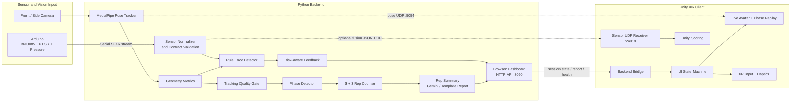

# SafeLift XR

Unity XR, MediaPipe 자세 추적, Arduino 센서를 결합해 스쿼트 동작을 분석하고 실시간 피드백과 운동 후 리뷰를 제공하도록 설계한 팀 프로젝트의 코드 포트폴리오입니다.

> 이 저장소는 핵심 구현과 시스템 설계를 소개하기 위한 **code-only portfolio**입니다. 전체 Unity 프로젝트, Scene/Prefab, Unity 자동 생성 캐시, 빌드 결과물, 모델 가중치, 실험 기록, 유료 또는 재배포 권한이 확인되지 않은 외부 에셋은 포함하지 않습니다. 따라서 이 저장소만으로 원본 XR 애플리케이션을 그대로 빌드하거나 실행할 수 없습니다.
>


데모 시현 영상
https://drive.google.com/file/d/1_5jJTvkIp4bED88vzb5ZjhIisX6IqzV6/view?usp=drive_link

🏆 **GIST AX-Challenge 2026 — 최우수상**

웨어러블 센서와 Unity XR을 결합한 실시간 스쿼트 자세 분석 및 피드백 시스템을 개발한 팀 프로젝트입니다.

https://juvenile-flier-c48.notion.site/EHC-AX-Challenge-5a7f4ecfcc2c825c9f8901bf347e27ba?source=copy_link

## Project Overview

SafeLift XR은 카메라 기반 자세 정보와 FSR·IMU·압력 센서 데이터를 하나의 session state로 정규화하고, Unity XR 클라이언트에서 운동 단계와 피드백을 표현하는 프로토타입입니다.

현재 소스의 기본 세션은 다음 순서로 구성됩니다.

```text
Start Dashboard
  → Tutorial / Calibration
  → SET 1 Practice (3 reps)
  → Rest
  → SET 2 Live Feedback (3 reps)
  → Report Generation
  → Post-Rep Avatar Review
  → Laptop QR Handoff
```

실시간 오류 판단은 rule-based pipeline이 담당합니다. Gemini는 운동 종료 후 자연어 리포트를 생성할 때만 선택적으로 사용하며, API key가 없거나 생성이 실패하면 template reporter로 대체됩니다.

## Project Motivation

스쿼트는 무릎 정렬, 발바닥 하중, 뒤꿈치 안정성, 몸통 기울기와 코어 압력처럼 동시에 확인해야 할 요소가 많습니다. SafeLift XR은 다음 문제를 하나의 상호작용 흐름으로 묶는 것을 목표로 했습니다.

- 사용자가 운동 중 화면에서 벗어나지 않고 XR 환경에서 피드백을 확인할 것
- 카메라 추정값과 물리 센서 값을 동일한 session contract로 다룰 것
- 불안정한 tracking frame이나 일시적인 sensor loss를 정상 데이터처럼 사용하지 않을 것
- 운동 중에는 짧고 제한된 cue를 제공하고, 상세 설명은 운동 후 review로 분리할 것
- 외부 AI 서비스가 없어도 핵심 판단과 리포트 흐름이 중단되지 않을 것

이 프로젝트는 의료기기나 임상적으로 검증된 진단 시스템이 아닙니다.

## Tech Stack

| Area | Technologies verified in source/configuration |
|---|---|
| XR Client | Unity 2022.3.55f1, C# |
| XR SDK | Meta XR SDK 201.0.0, Oculus XR Plugin 4.4.0 |
| Interaction | XR Interaction Toolkit 2.6.3, Input System 1.11.2 |
| Avatar/UI | Humanoid Animator, TextMesh Pro, Unity UI, Animation Rigging |
| Vision Backend | Python, OpenCV, MediaPipe 0.10.21, NumPy |
| Sensor Backend | pyserial, validated JSON/JSONL/HTTP sensor providers |
| Report | Google Gen AI SDK with template fallback, browser report, QR handoff |
| Embedded | Arduino, BNO085 IMU, 6-channel FSR, SEN-16476 pressure sensor |
| Transport | HTTP :8090, sensor UDP :24018, avatar UDP :5054, Serial 115200 baud |

Unity package versions are preserved in [`config/unity/manifest.json`](config/unity/manifest.json), and Python dependencies are listed in [`backend/requirements.txt`](backend/requirements.txt).

## System Architecture



세부 데이터 계약은 [`docs/sensor-protocol.md`](docs/sensor-protocol.md)와 [`docs/backend-api.md`](docs/backend-api.md)를 참고하세요.

## Key Features

### 1. Tracking-aware squat repetition counting

`PhaseDetector`는 hip height의 시간 이력과 평균 knee angle을 이용해 `Standing`, `Descent`, `Bottom`, `Ascent`를 분류합니다. `SquatRepCounter`는 단순 phase 변화만으로 횟수를 증가시키지 않습니다.

- `Standing → Descent → Bottom → Ascent → Standing` 순서 요구
- 분석 가능한 lower-body tracking 요구
- hip displacement와 knee flexion을 모두 요구
- 최소 rep duration을 적용해 한두 frame의 튐을 거부
- tracking gap이 길어지면 진행 중인 rep candidate를 초기화

현재 실제 코드의 기본값은 **SET당 3회, 총 6회**입니다.

### 2. Multi-modal posture feedback

`RuleErrorDetector`는 pose metric과 normalized sensor frame을 함께 사용합니다.

- torso lean
- shallow depth
- knee valgus
- left/right weight asymmetry
- heel pressure drop
- core pressure drop
- IMU roll 또는 instability 기반 torso instability
- tracking uncertainty

이 조건은 코칭용 prototype rule이며 임상 판정 기준이 아닙니다.

### 3. Feedback prioritization instead of cue flooding

`RiskAwareFeedbackEngine`은 검출된 모든 오류를 동시에 보여주지 않습니다.

- squat phase별 오류 우선순위
- 동일 오류 2초 cooldown
- phase당 최대 2개 cue
- rep당 최대 3개 cue
- 선택되지 않은 오류와 선택 이유를 report evidence로 보존

### 4. Validated sensor boundary

`SensorFrame.from_payload()`가 provider와 분석 코드 사이의 validation boundary 역할을 합니다.

- pressure ratio와 instability: `0.0..1.0`
- IMU pitch/roll: `-180..180` degrees
- boolean-compatible heel/forefoot flags
- FSR scoring type: `A` 또는 `B`
- invalid payload에는 `contract_ok=false`와 구체적인 `contract_errors` 기록

Serial, JSONL replay, HTTP push provider가 같은 contract를 사용합니다.

### 5. Unity-owned scoring

Unity의 `SafeLiftScoring`과 Python의 report rubric은 100점 prototype scoring을 구성합니다.

| Component | Maximum |
|---|---:|
| Ground balance / FSR | 35 |
| Core bracing | 35 |
| Spine alignment | 30 |

센서 증거가 부족한 경우 완성된 점수로 가장하지 않고 `NO_SIGNAL`, `INVALID` 또는 incomplete evidence 상태를 유지합니다.

### 6. XR interaction and post-rep review

- Quest controller와 hand pointer 기반 UI interaction
- rep 완료, 체중 이동, core pressure drop, tracking 문제별 haptic channel
- live Humanoid avatar 연결
- Standing/Descent/Bottom/Ascent pose snapshot 기록
- 운동 후 avatar front/side/rotate/zoom review
- avatar 또는 snapshot이 없을 때 placeholder fallback

### 7. Report and QR handoff

운동 후 backend는 phase capture, metric, sensor summary, feedback trace와 set comparison을 report payload로 정리합니다. Gemini를 사용할 수 없으면 deterministic template report를 반환합니다.

QR 이미지는 HMD 내부가 아니라 laptop browser의 `/qr` 페이지에서 제공하도록 구현돼 있습니다. 현재 dashboard는 QR 이미지 생성용 외부 서비스 URL을 만들 수 있으므로, 실제 배포 전 개인정보·네트워크 정책 검토가 필요합니다.

## Implementation Details

### Unity data flow

1. `SafeLiftBackendBridge`가 `/api/session_state`, `/api/latest_report`, `/api/health`를 polling합니다.
2. `SafeLiftSquatSensorUdpReceiver`가 별도 fusion process의 UDP 24018 JSON을 수신합니다.
3. `SafeLiftUIStateMachine`이 calibration, set progress와 화면 전환을 관리합니다.
4. `SafeLiftUnityScoreController`가 sensor snapshot과 backend state를 scoring input으로 변환합니다.
5. `SafeLiftPhasePoseRecorder`가 phase별 Humanoid bone pose를 저장합니다.
6. `SafeLiftAvatarReviewController`가 저장된 pose와 issue overlay를 review 화면에 표시합니다.

### Backend data flow

1. OpenCV camera frame을 `MediaPipePoseTracker`가 landmark로 변환합니다.
2. `geometry.py`가 knee angle, torso angle, hip height, knee valgus metric을 계산합니다.
3. `TrackingQualityGate`가 분석 및 avatar 송신 가능 여부를 별도로 판단합니다.
4. `PhaseDetector`와 `SquatRepCounter`가 squat 단계 및 rep를 갱신합니다.
5. `RuleErrorDetector`와 `RiskAwareFeedbackEngine`이 cue를 선택합니다.
6. `RepSummaryBuilder`가 운동 후 evidence를 구성합니다.
7. `BrowserDashboard`가 Unity API, health page, report와 QR page를 제공합니다.

### Arduino stream

Arduino sketch는 50ms 주기로 다음 CSV 형식의 `SLXR` line을 출력합니다.

```text
SLXR,millis,fsr1,fsr2,fsr3,fsr4,fsr5,fsr6,
accX,accY,accZ,gyroX,gyroY,gyroZ,
quatW,quatX,quatY,quatZ,pressure_kPa
```

Python의 `ArduinoSlxrNormalizer`가 raw channel을 backend의 normalized `SensorFrame`으로 변환합니다. 실제 hardware calibration 값은 장치와 사용자에 맞게 별도로 설정·검증해야 합니다.

## Challenges & Solutions

### Camera jitter가 rep로 잘못 계산되는 문제

단일 phase 전환 대신 ordered phase sequence, hip/knee movement amplitude, 최소 소요 시간과 tracking gate를 함께 적용했습니다.

### 일시적인 landmark 손실로 분석과 avatar가 동시에 멈추는 문제

분석용 strict gate와 avatar transport용 tolerant gate를 분리했습니다. 분석 신뢰성이 낮은 frame은 점수와 rep에서 제외하면서 avatar는 짧은 landmark 손실에 대해 마지막 안전 자세를 유지할 수 있습니다.

### 여러 오류가 동시에 검출될 때 피드백이 과도해지는 문제

phase별 우선순위, cooldown, phase/rep별 cue 수 제한을 적용했습니다. 선택되지 않은 오류도 report evidence에 남깁니다.

### 센서 provider별 입력 형식과 오류 처리 차이

Serial, JSONL과 HTTP provider 앞에 동일한 `SensorFrame` validation contract를 배치했습니다. Unity는 invalid/stale data를 정상 센서 신호처럼 사용하지 않습니다.

### Quest에서 `127.0.0.1`이 개발 PC를 가리키지 않는 문제

Editor에서는 localhost를 사용하고, standalone Quest에서는 같은 Wi-Fi의 PC IPv4 URL을 입력·저장할 수 있도록 backend URL 설정 흐름을 분리했습니다.

### 외부 AI 서비스 실패가 전체 운동 흐름을 중단하는 문제

실시간 판단은 전부 rule-based로 유지하고, 운동 후 보고서만 Gemini에 위임했습니다. API key 누락, timeout 또는 오류 시 template reporter가 동작합니다.

## Results

이 저장소에서 확인·검증한 결과는 코드 수준에 한정됩니다.

- scoring rubric 검증: **24/24 통과**
- sensor contract 검증: **12/12 통과**
- 42개의 프로젝트 전용 Unity runtime C# script 선별
- Python analysis, sensor, report와 browser API source 포함
- Arduino sensor acquisition sketch 포함
- secret pattern 및 개인 사용자 절대경로 미검출

다음 항목은 이 저장소에서 성과로 주장하지 않습니다.

- 실제 사용자 자세 교정 효과 또는 정확도
- 임상·의료적 유효성
- Meta Quest 실기기 전체 기능 검증
- 실제 센서와 카메라를 동시에 사용한 장시간 안정성
- Gemini 보고서의 품질 또는 사용자 만족도
- 개인별 기여 범위

## Repository Structure

```text
SafeLift-XR-Portfolio/
├── README.md
├── NOTICE.md
├── .gitignore
├── unity/
│   ├── Core/
│   ├── Feedback/
│   ├── Avatar/
│   ├── XRInteraction/
│   └── Support/
├── backend/
│   ├── main.py
│   ├── requirements.txt
│   ├── analysis/
│   ├── camera/
│   ├── capture/
│   ├── reports/
│   ├── sensors/
│   └── ui/
├── arduino/
│   └── SafeLiftArduinoSensors.ino
├── config/unity/
├── docs/
│   ├── architecture.md
│   ├── backend-api.md
│   ├── sensor-protocol.md
│   ├── limitations.md
│   └── screenshots/
└── tests/
    ├── fixtures/
    ├── verify_score_rubric.py
    └── verify_sensor_contract.py
```

## Running the Included Checks

Python 3.11 기준으로 작성됐습니다.

```powershell
python -m venv .venv
.\.venv\Scripts\Activate.ps1
python -m pip install -r backend\requirements.txt
python tests\verify_score_rubric.py
python tests\verify_sensor_contract.py
```

검증 스크립트는 scoring과 normalized sensor contract를 확인합니다. 전체 Unity scene 또는 XR runtime 테스트는 아닙니다.

## Running the Backend

실제 카메라 및 필요한 dependency가 있는 경우 다음 형태로 backend를 실행할 수 있습니다.

```powershell
python backend\main.py --camera auto --browser --web_host 127.0.0.1 --web_port 8090 --no_gemini
```

중요한 제한:

- 이 코드 snapshot의 `run_mock_session()` helper는 `main.py` 안에 존재하지만 현재 CLI parser에 `--mock_session` 옵션이 연결돼 있지 않습니다.
- 전체 runtime harness는 이 불일치 때문에 포트폴리오에서 제외했습니다.
- camera, MediaPipe와 실제 sensor provider 없이는 Real Mode end-to-end flow를 검증할 수 없습니다.
- 실행 중 생성되는 `outputs/`와 `report_archive/`는 Git 추적 대상이 아닙니다.

## Unity Integration Notes

`unity/`는 원본 `Assets/SafeLiftXR/Scripts`에서 선별한 코드입니다. 아래 항목이 제외되어 있으므로 새 Unity 프로젝트에 그대로 복사해도 완전한 scene을 재현할 수 없습니다.

- `.unity` scenes와 prefab reference
- `.meta` GUID와 serialized scene binding
- UI image, audio, font와 tutorial resources
- Meta XR sample assets
- avatar model, animator controller와 third-party IK assets
- Indoor Gym environment
- Android manifest 및 원본 ProjectSettings 전체

또한 원본 스크립트 일부는 Meta XR SDK, TextMesh Pro, XR Interaction Toolkit type을 참조합니다. 해당 package가 없는 프로젝트에서는 compile error가 발생할 수 있습니다.

## Demo & Screenshots

현재 공개본에는 screenshot을 포함하지 않았습니다. 원본 capture에는 실제 인물 또는 촬영 환경이 포함됐을 가능성이 있고, Unity UI 및 environment에는 외부 에셋이 포함돼 있어 공개 권한을 먼저 확인해야 하기 때문입니다.

공개 전 다음과 같은 직접 제작·승인된 이미지를 `docs/screenshots/`에 추가하는 것을 권장합니다.

1. Start Dashboard와 Real Mode preflight
2. SET 2 realtime feedback panel
3. Post-Rep avatar phase review
4. Laptop browser report 및 QR handoff

## Security & Privacy

- API key는 저장소에 넣지 말고 `GEMINI_API_KEY` 환경변수로 전달합니다.
- `.env`, report archive, camera capture와 runtime output은 `.gitignore`에 포함됩니다.
- backend를 `0.0.0.0`에 binding하면 같은 네트워크의 다른 장치가 접근할 수 있으므로 trusted network에서만 사용해야 합니다.
- report 또는 QR URL에 개인 데이터가 포함되지 않는지 확인해야 합니다.
- 외부 QR service 사용 시 report URL이 해당 서비스로 전달될 수 있습니다.

## Limitations

상세 내용은 [`docs/limitations.md`](docs/limitations.md)를 참고하세요.

- code-only snapshot이며 전체 Unity 프로젝트가 아님
- scene/prefab/assets가 없어 Unity standalone build 불가
- 실제 sensor calibration 값 미포함
- mock runtime helper와 CLI parser가 현재 연결되지 않음
- 팀 프로젝트의 개인별 담당 범위가 소스에서 확인되지 않음
- 실기기 및 사용자 실험 결과 미포함

## Team Project & License

이 프로젝트는 팀 프로젝트입니다. 현재 제공된 소스와 문서만으로 개인별 담당 역할을 신뢰성 있게 구분할 수 없어 README에 임의로 역할을 배정하지 않았습니다.

또한 저장소 전체에 적용할 라이선스가 팀 차원에서 확정됐다는 근거가 없어 `LICENSE` 파일을 추가하지 않았습니다. 공개 전 팀 구성원과 코드 공개 범위 및 라이선스를 합의해야 합니다. 라이선스가 없는 공개 저장소는 기본 저작권 상태가 적용되며, 제3자가 자유롭게 복제·수정·배포할 수 있는 오픈소스 저장소로 간주되지 않습니다.

제외한 외부 리소스와 공개 전 확인사항은 [`NOTICE.md`](NOTICE.md)를 참고하세요.
